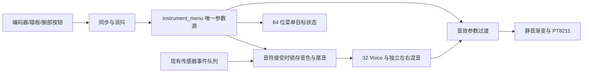

# 菜单到音频参数接入

2026-10-17。开发组件位于 `fpga/controlled_audio/`。菜单设置现已连接真实的 Voice 调度器、振荡器、ADSR、立体声混音、音效和 PT8211 数字输出。它尚未接入 DUO02 板卡顶层，没有新位流、外部引脚或实物验证。

## 信号连接与单一参数来源

`menu_performance_core` 内只有一份 `instrument_menu` 参数寄存器。输入是 `performance_controls` 产生的单周期语义事件：旋转方向/步进、编码器短按/长按、踏板、左右腕部短按/长按。机械滤波本身继续使用已有模块，不能把未经同步消抖的引脚直接接到语义事件端口。



图中接收传感器队列之后的音频路径已做数字检查；外部实体输入、I²C 与 HDMI 的同一板卡顶层仍待连接和验收。

| 接口 | 使用要求 |
| --- | --- |
| `event_valid/ready/data` | 直接使用 `two_hand_i2c_core` 的 64 位事件和背压握手；不能再插入第二份队列 |
| `release_pending/ack`、`epochs` | 与同一传感器队列连接，保持两手取消代际和确认，不得跨接其他队列的状态 |
| `imu_enabled` | 当前两手使能状态，用于腕部归中资格和湿声清除 |
| `calibrate`、`profiles` | 送回现有传感器核心，分别请求归中和每手 7/5/12 布局 |
| `clear_history` | 每手生命周期清除请求：板卡适配器合并传感器重启、掉线、故障、复位等边界；本模块额外合并归中及使能下降沿 |
| `control_status` | 与既有菜单绘制相同的 64 位格式，表示菜单目标值；送帧快照和 `menu_panel`，不要再实例化另一份菜单控制器 |
| `active_effect/actual_wet/active_delay/active_feedback/active_depth` | 实际生效参数；过渡中可以不同于菜单目标值 |
| `transitioning` | 结构参数、湿声或反馈尚未达到请求值；显示集成时应据此提示过渡 |

所有控制请求和事件接口均处于核心时钟域。显示仍应使用原有请求/应答帧快照，不能逐位异步采样这些总线。`controls_enabled` 只停用菜单操作，保留演奏参数，不是 IMU 或电源使能。

## 演奏参数的生效时机

- 音色和尾音由调度器在接受新 Note-On 时锁存。修改左手参数不会改变右手或已经发出的音符；后续音符使用新值。
- 踏板改变后续左手事件的三和弦/单音模式，右手维持单音旋律。已经发出的音符不会随菜单切换突然重配。
- Roll/Pitch 表情沿用各手的弯音、颤音和明亮度总线，保留原 Voice 所有权。
- 归中、停用与传感器取消仍由生产者队列发布 epoch/release 握手，消费端排空该手的 gate-off 配置后确认；另手继续演奏。清除湿声历史不等于截断干声自然尾音。

这里不重新判断动作。负 Z 线性加速度 **或**负向急动度的判定继续位于现有传感器/手势核心；本组件只消费已经合法生成的事件，不会把正 Z 动作重新解释为击发。

## 可调音效与过渡

`parameter_stereo_output` 接收效果、湿声、延迟、反馈和合唱深度的完整请求。左右声道保留独立的 16384 采样历史；没有新增一套延迟 RAM。

1. 效果类型、延迟或深度变化时，保持旧参数，按每个已接受音频采样将湿声降低 1/256。
2. 湿声为零时，锁存当时最新的完整请求，同时清除两通道历史有效性、反馈从零开始。连续旋转期间以最新请求为准，不按旧编辑队列依次回放。
3. 湿声和反馈各按 1/256 每采样趋近目标值。48 kHz 下，全幅渐变最多约 5.33 ms；这不是整机动作至声音的延迟测量。
4. 只改反馈或湿声时不清除历史。反馈在延迟模式限制为 192/256，简化混响限制为 128/256，合唱与旁路为零。数值越界由输出路径再限幅。
5. 效果后主音量用 256 个采样渐变。默认静音；功放关闭标志在实际增益为零时有效。

菜单延迟范围 48～16368 个采样；输出模块自身支持 1～16383，并按实际 RAM 深度限幅，避免未来其他控制源越界。湿声最大 255/256；界面百分比取整数部分，255/256 显示 99%，不表示内部湿声分母改成了 255。

这些处理用于减小参数跳变和旧历史重现；数字通过不能证明实物音频没有爆音，仍需听音及模拟输出测量。

## 检查与资源

```powershell
python -X utf8 fpga/tools/check_controlled_audio.py
python -X utf8 fpga/tools/synth_controlled_audio.py
python -X utf8 fpga/tools/synth_controlled_audio.py --performance
python -X utf8 fpga/tools/check_controlled_audio.py --verify
```

### 本轮记录

- `tb_parameter_stereo_output`：parameter stereo output: default 16384 RAM, 50MHz/48kHz, exact 48/96 sample echoes, wet drain/atomic latest tuple/history clear, feedback slew/clamps, independent hand clear, gain ramp, 4198 frames 8393 PT8211 words。
- `tb_menu_performance_core`：canonical semantic menu -> actual 32 Voice/16384 FX/PT8211: per-hand next-note tone/release snapshot, pedal future triad, actual effect delay/wet/feedback/depth, calibration/disable ownership, 32 unique concurrent notes + wet255 feedback128 reverb + live expression, independent golden bank sums, mute ramp, 6632 serial words 4676 nonzero max render 385 clocks。

| 未布局综合范围 | Register | LUT | ALU | BSRAM |
| --- | --- | --- | --- | --- |
| 可调输出路径（含音效 RAM） | 497 | 766 | 525 | 32 |
| 菜单＋32 Voice＋可调音效＋DAC（无传感器/HDMI/机械滤波） | 13095 | 24055 | 2504 | 49 |

乘法原语按报告分别列出，不能将不同种类原语数量直接相加为整机 DSP 百分比。没有布局布线、Fmax 或物理引脚结果。

检查证据、最终串行字数及资源以 `board-test/controlled-audio/` 中当前清单和日志为准；综合报告在 `fpga/reports/controlled_audio/`。这两个 GPRJ 只有综合入口，没有板卡约束、布局布线或可下载位流。资源不能当作主工程新增量，也不证明 50 MHz 时序。

`tb_parameter_stereo_output` 使用完整 RAM 和实际 50 MHz/48 kHz DAC：核对 48/96 采样回声、192/256 反馈的连续衰减值、左右独立清除、结构参数湿声归零后原子提交、快速编辑取最新值、反馈限幅/渐变、深度、旁路、延迟边界和静音。

`tb_menu_performance_core` 从语义菜单事件经过真实调度器/合成器/音效/DAC：验证两手新旧音符参数锁存、踏板只影响未来左手和弦、实际音效参数、归中/停用隔离、32 个不同音高同时活动、最大菜单混响反馈与湿声、动态表情、逐声部参考混音、串行左右字和静音。传感器侧使用同格式队列及合成事件，机械滤波、真实 I²C 和 HDMI 不在本检查内。

## 后续板卡接入

DUO02 保持冻结。新增板卡版本还需：外部 GPIO 原理图核对；板载键与外部菜单共用同一参数状态；传感器核心与本文接口连接；演奏/诊断/菜单页的帧同步切换及实际生效提示；完整路由、时序和原生板卡链路回归。

DUO02 报告的首条 setup 路径从 `instrument/synth/scheduler/choice_2_s0` 到 Voice revision 寄存器使能，余量仅 0.010 ns，choice 输出扇出 935。后续需处理分配器选择/写回路径并重做布局布线；本次独立综合没有修复或证明该整机关键路径。真实双手、听音、识别率、漂移、延迟和长时间负载仍需实测。
