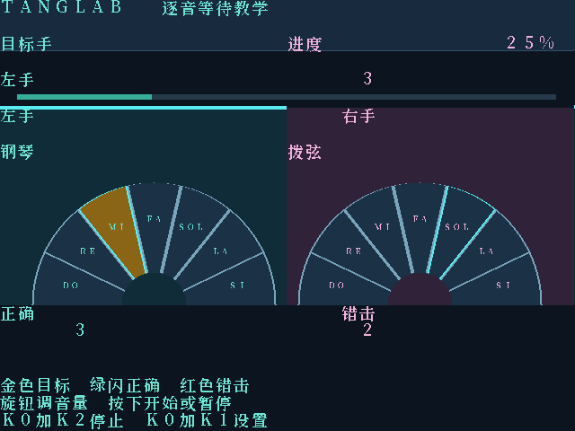
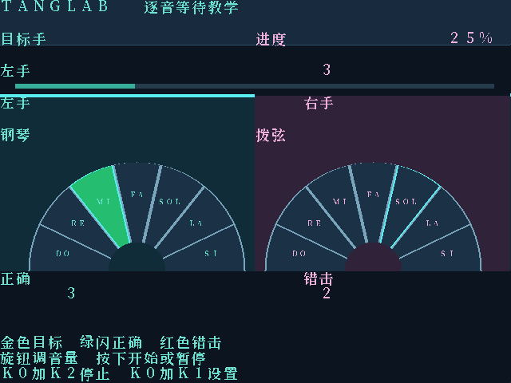
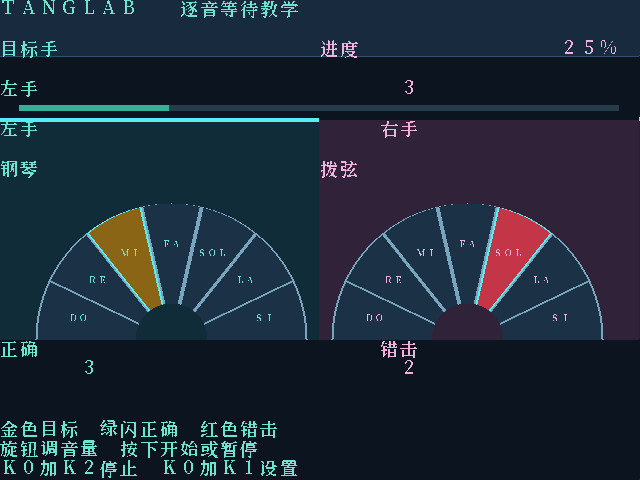
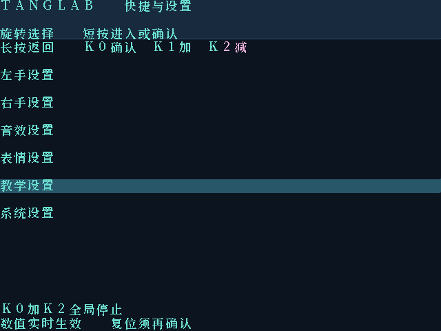
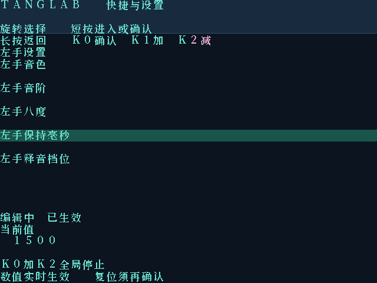
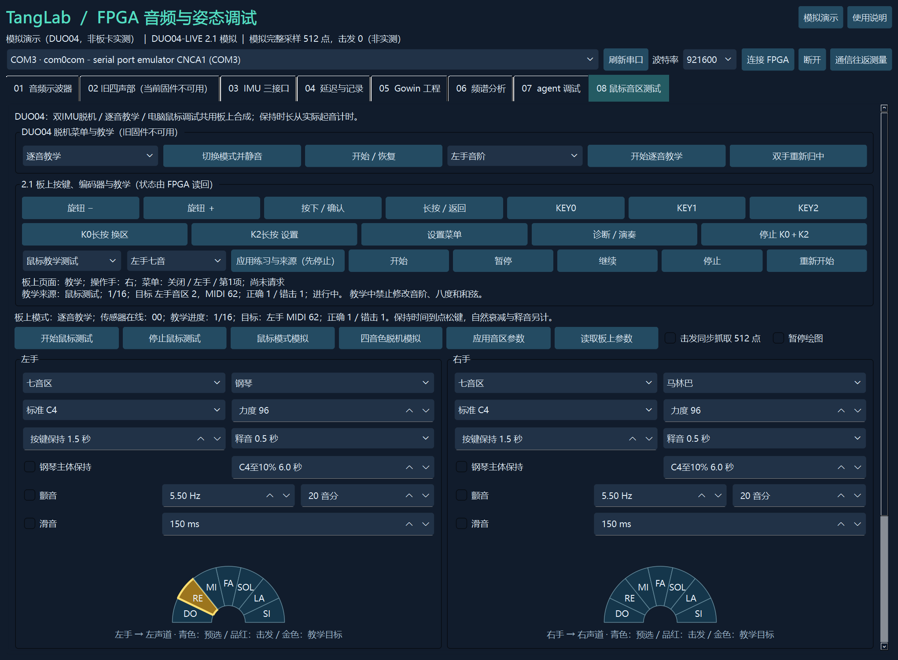

# 交互2.1 操作图解

详细接线和步骤见[操作指南](脱机演奏与教学指南.txt)。先使用鼠标教学，无需连接IMU或编码器；连接新位流后选鼠标教学来源、应用、开始。按键快捷动作和编码器数值编辑共用板上状态。

下图均为 RTL 渲染或明确标注模拟的上位机截图，不是实物显示器拍摄。

## 双扇区教学

金色是目标，青色是实际预选。正确时绿色闪亮250ms再推进；错误红色180ms，目标不变。

## 分组与数值

短按编码器先开快捷菜单，再次确认才执行。设置分左手、右手、音效、表达、教学、系统；编辑实时生效，复位/重来须确认。教学完成后快捷开始可重新练习。

## 不接编码器也能验证

第08页虚拟按键与旋钮控制真实板上菜单，当前操作手、目标和进度由板上读回；共享波形仍可浮动显示。

新版RTL需自行综合、布线并下载；本包没有新版.fs。PR1014、物理TMDS、实体双IMU/编码器及模拟音质待实测，HDMI教学不替代实体LED要求。
